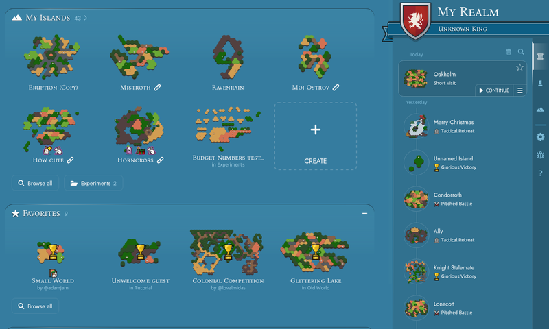
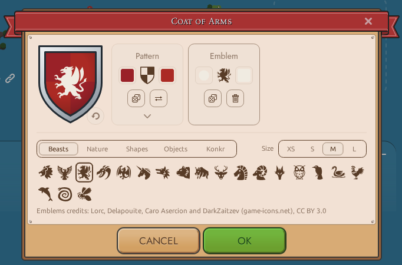
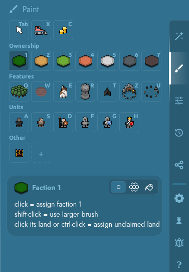
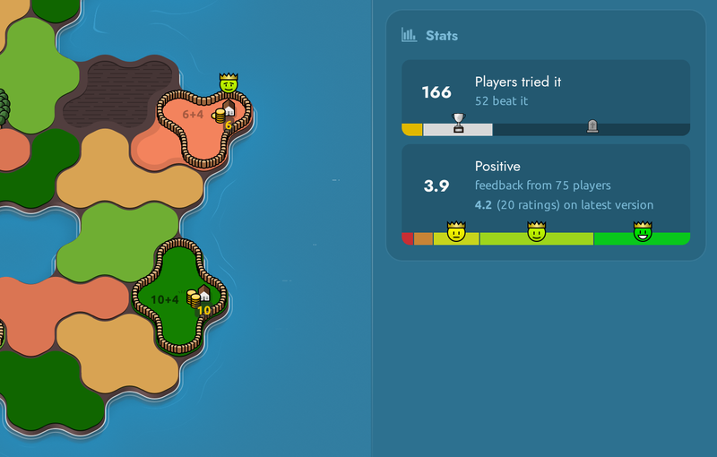
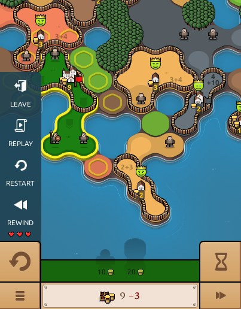
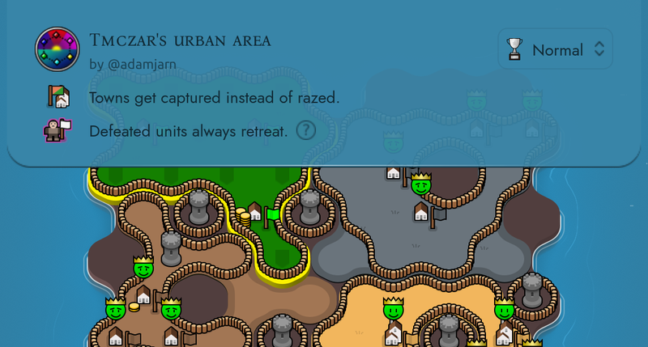

It took a while, but **the Map Editor update is here!** Paint your own islands and torture your friends with the hardest levels you can make! 

<!-- excerpt-end -->

## 🥁 Introducing...

### 🏰 My Realm

The new home for _your stuff_ in Konkr!
 - Make it truly yours with a custom coat of arms and name. 
 - **My Islands** is where your own creations go.
 - **Chronicles** is what I call the drawer on the right side, which shows your recent play history - an easy way to revisit a previously played level or replay!
 - **Favorites** is where you can bookmark your favorite levels, be it expeditions, conquest or custom levels shared by other players. You can use the ☆ star button to add levels to your favorites from the level menu or victory screen.
 - **Conquered Isles** is a catalogue of all the expedition and custom islands you've conquered so far (conquest victories don't show there for now).
 - Dive deeper into each section with a full-featured island browser, which lets you sort, filter and group things in all sorts of ways; you can also drag and drop to reorder your islands and even organize them into named collections.
 - All of this is automatically backed up to the cloud and shared across your devices when you're signed in. You can also easily download all the content in your realm to a single backup file. 

### 🛠️ The Map Editor

Start from a blank sea or a random island, paint it, set its rules and hit PLAY to see if it holds up. The editor's tabs:
- **Generate** a random island with the Conquest map generator, when a blank slate doesn't spark your imagination.
- **Paint** the island: land, provinces, forests, towns, units and coins. This is where you'll spend most of your time.
- **Configure** its introduction text, theme and rule modifiers.
- **Versions** are like rewinds, but for the editor. They keep your editing history and let you add a short note to the versions you want to keep.
- **Sharing** sends your island to anyone with a link - more on that in the next section!

Want to remix a level? The  button in the level menu copies it into your Realm, ready to edit.
The map editor is **fully usable on phones** as well. Try finger-painting some Konkr maps!

Have fun with it and let me know if you run into any trouble or confusion using it! I'm betting on things being mostly intuitive,
but might add some dedicated help pages if needed.

### 🔗 Sharing islands
Go to the **Sharing** tab in the map editor to share your creations with other players through a simple link. 
For example, here's [Afar](https://www.konkr.io/levels/cl-oBOwncfO), a shared island I made for you to celebrate the feature!  

After you've shared your island, you can also see how many players played it, how many managed to beat it and their feedback ratings on the classic  scale.

For now, the place to share your islands with the wider community is still the [#custom-maps](https://discord.com/channels/809676281775390770/1310574849583747194) channel on the [Konkr Discord server]({{ site.discord_link }}).
An in-game community island browser is the obvious next step, stay tuned for that!

### 📱 Phone UI refresh

Konkr on phones got a lot of new stuff, including access to these news posts! Here's what else is new:

- The ☰ menu moved from the annoyingly remote top-right corner to the bottom left
- Tapping the undo button at the start of your turn now gives you quick access to rewind and restart, just like on PC
- The level menu also got a redesign to be more suitable for the phone screen
- You can now regulate the rival turn playback speed without going into the options
- Tapping your town now turns on **Muster mode** (more on that below)
- And lots of little touches on other screens too to make the phone experience smoother

More upgrades are coming to make the Konkr experience on phones truly equal to the desktop one. No more second-class citizen treatment for phone players!  

### 🎮 Less clicking, more conquering
- **Muster mode**: hold Shift on desktop, or tap your town on phones, and your next click merges or buys units right where you point - now also on your own territory, not just when attacking.
- **Level intro**: when you enter a new expedition or shared level, a small panel informs you about any non-standard objectives and game modifiers plus the current difficulty
- You can now freely change the rival AI difficulty until the end of the first turn

### 📬 The Konkr Newsletter

Want to hear about the next big update without checking the blog? Konkr now has a newsletter. Don't worry, it won't be every blog post: I've capped myself at 4 emails a year, for the big stuff only, like new expeditions or features as big as this one.

If you're signed in, subscribing is one click on your Profile page (or on the expeditions screen). A sign-up for players without an account will come later.

## What's next

First of all, I think I should take a break from Konkr for at least a few days. I've been a little too obsessed with finishing the update in the past weeks;
touching some grass and getting proper sleep for a change is in order 😅.

After that, there is one obvious thing still missing from the *Map Editor & Map Sharing* milestone on [my roadmap](#on-the-horizon) - the in-game community island browser!
Aside from responding to your bug reports and feedback, this will probably be my next focus, along with more UI and map editor improvements as we go.

## ❤️ Thank you

It's hard to describe how good it feels to finally release this update, almost 2 years since I kicked off the map-editor branch. Thank you for being with me on this journey, I bet it's only gonna get more exciting from here!

Many things have changed in the game today, but what will always remain true is that your feedback, bug reports and ideas are what make it truly shine. Some of the improvements in this update came straight from your ideas, and I owe special thanks to the Discord heroes who helped me polish it in the [#dev-build](https://discord.com/channels/809676281775390770/1559276137115549859) channel!

I also keep improving my stats collection to get a better bird's-eye view of how people play the game: which levels they love, which ones they rage-quit, which features get used and which nobody finds. You can now opt out of this stats collection in Settings, but it helps me a lot when you don't 🙂.

Thanks for reading, I hope you will love the update as much as I loved making it!

<small>And obligatory reminder: found a bug, or have an idea that would make Konkr better? Hit the feedback button in the game, or drop it in [#feedback-and-ideas](https://discord.com/channels/809676281775390770/1028729822119198800). 
I&nbsp;want to know what you think!</small>